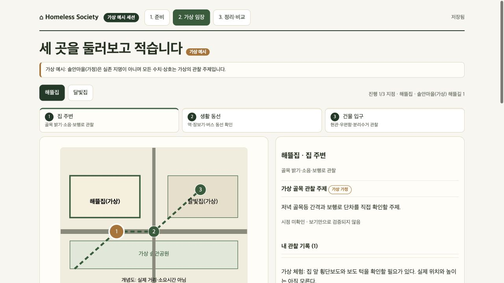

# Homeless Society

> 한국의 첫 집 마련을 준비하는 분을 위한 오픈소스 가상 임장 노트입니다. 집을 비교하는 세입자에게도 유용합니다.

[English](README.en.md) · [짧은 한국어 안내](README.ko.md) · [상세 이용 안내](docs/GETTING_STARTED.ko.md)

## 이 프로젝트는 무엇인가요?

Homeless Society는 실제 방문 전에 준비→가상 임장→정리·비교 흐름을 연습하는 브라우저 앱입니다. 관심사를 고르고 후보 집을 정리한 뒤, 관찰 지점별로 메모를 남기고 마지막에 두 집을 나란히 비교합니다. 그 결과로 방문 체크리스트와 다시 볼 수 있는 기록 파일이 남습니다.

임장은 마음에 둔 집과 주변 동네를 직접 찾아가 살펴보는 일을 말합니다. 낮과 밤의 골목 분위기, 걸어 다니는 길, 건물 입구의 모습을 서류 너머에서 확인하는 과정입니다. 이 앱은 직접 방문을 대신하지 않으며, 방문 전에 무엇을 볼지 정리하도록 돕습니다.

## 왜 만들었나요?

한국에서 집을 구할 때는 큰 금액이 오가고 확인해야 할 정보가 여러 곳에 흩어져 있습니다. 전세사기로 드러난 주거 정보 격차는 처음 집을 사는 분에게 특히 막막하게 느껴질 수 있습니다. 이 프로젝트는 그런 분이 혼자서도 차분히 준비할 수 있도록 독립적인 확인 노트를 제공하려는 동기에서 시작했습니다.

이 앱은 사기를 판별하거나 안전을 보장하지 않으며, 중개 서비스나 가격 예측을 제공하지 않습니다. 측정한 효과나 안전에 대한 약속도 하지 않습니다. 사용자가 직접 보고 질문을 정리하도록 돕는 범위에 집중합니다.

## 누구에게 유용한가요?

| 대상 | 얻는 것 |
|---|---|
| 첫 집 마련을 준비하는 분 | 확인할 관점과 후보 정리, 방문 준비물 |
| 집을 비교하는 세입자·동행자 | 집 두 곳의 관찰과 질문을 나란히 정리한 노트 |
| 기록하며 고르고 싶은 분 | 저장·인쇄·가져오기가 되는 확인 기록 |

## 화면으로 보기



*위 화면은 가상의 예시이며, 앱에 포함된 오리지널 도식 화면입니다. 실제 지도 사진이나 로드뷰가 아닙니다.*

버튼 이름까지 포함한 순서는 [상세 이용 안내](docs/GETTING_STARTED.ko.md)에서 확인할 수 있습니다.

## 예시 이야기: 집 두 곳 비교하기

지은 씨는 같은 동네에서 해뜰집과 달빛집을 고민하는 가상 인물입니다. 지은 씨는 준비 단계에서 관심사 세 가지를 고르고 첫 질문을 적은 뒤, 가상 예시로 두 집을 번갈아 살펴봅니다. 각 지점에서 본 것과 궁금한 점을 적고, 정리 화면에서 무엇을 알았고 무엇을 아직 모르는지 확인한 뒤 체크리스트를 내려받습니다. 자동 추천이나 점수는 없으며, 선택은 지은 씨가 직접 합니다.

아래는 작성을 연습하기 위한 예시 문장이며, 저장된 실제 Muse 출력이 아닙니다.

- 해뜰집 연습 예시 관찰: `낮에는 골목이 밝아 보였으나, 밤 귀갓길의 가로등 간격은 아직 모른다.` / 연습 예시 질문: `밤 10시 이후 골목 입구부터 현관까지 어디가 가장 어두운지 다시 확인하고 싶다.`
- 달빛집 연습 예시 관찰: `장보기가 가까운 동선은 확인했으나, 저녁 시간대 골목 소음은 아직 모른다.` / 연습 예시 질문: `평일 저녁에 창문을 열었을 때 들리는 소리를 확인하고 싶다.`

지은 씨는 각 집에서 **기록 추가**를 눌러 저장한 뒤 집이나 지점을 바꿉니다. 이후 **정리·비교로**에서 집별 메모를 모으고, **방문 체크리스트 저장**과 **기록 JSON 저장**으로 결과를 내려받습니다. 이것이 준비부터 관찰 두 건, 검토와 내보내기까지 이어지는 기본 여정입니다.

## 이용 흐름

| 단계 | 하는 일 | 얻는 것 |
|---|---|---|
| 1. 준비 | 관심사 3개까지 고르기, 주소 확인 | 확인할 관점과 후보 집 정리 |
| 2. 가상 임장 | 집 주변·생활 동선·건물 입구 관찰 기록 | 집별 관찰 노트와 남은 질문 |
| 3. 정리·비교 | 메모 저장, 체크리스트와 기록 내려받기 | 방문 준비물과 다시 볼 기록 |

준비에서는 통근 동선, 장보기, 밤 귀가 확인, 건물 접근 중에서 최대 3개를 고릅니다. 첫 질문과 주소를 함께 적고, 공식 지도 링크로 주소를 직접 확인한 뒤 확인란에 표시합니다. 가상 임장에서는 후보 집을 바꿔가며 관찰 내용, 남은 질문, 출처를 적습니다.

정리·비교에서는 관찰한 것과 아직 모르는 것을 나란히 봅니다. 집마다 날짜가 들어간 방문 메모를 적고 **메모 저장**을 누릅니다. 집이나 지점을 바꾸기 전에는 **기록 추가**로 먼저 저장하세요. 저장하지 않은 입력은 사라질 수 있습니다.

## 시작하기 전에

준비물은 Git과 Node.js입니다. Node.js는 `22.22.3`에서 테스트했으며, 엔진 요구 조건은 `>=22.12`입니다. npm은 Node.js에 포함되어 있습니다. 공식 Git과 Node.js 설치를 권장합니다. 현재 동작은 macOS에서 확인했습니다. 공개된 체험용 누리집은 없습니다.

처음 데모에는 API 키나 `.env` 파일이 필요 없습니다. **가상 예시로 체험**은 유료 AI 호출 없이 실행됩니다. 이는 데모에 관한 설명이며, 향후 외부 API 사용이 모두 무료라는 뜻이 아닙니다. Meta 이용 자격과 요금은 본인 계정에서 확인하세요.

## 바로 체험하기

```sh
git clone https://github.com/halo-sw/homeless-society.git
cd homeless-society
npm ci
npm run dev
```

브라우저에서 http://127.0.0.1:5173 을 엽니다. **가상 예시로 체험**을 누르면 주소 입력 없이 가상의 솔안마을이 열립니다. 해뜰집과 달빛집이 나오며, 앱에 포함된 오리지널 도식 화면입니다.

실제 지도, 실제 사진, 도보 시간 계산은 데모에 들어 있지 않습니다. 멈출 때는 터미널에서 `Ctrl+C`를 누릅니다. 운영 형태의 주소가 궁금하면 [상세 이용 안내](docs/GETTING_STARTED.ko.md)를 보세요.

## 내 주소로 살펴보기

주소 입력 양식은 첫 화면에 바로 보입니다. 기본 주소와 선택 사항인 별명, 선택 사항인 두 번째 후보를 적습니다. 관심사를 최대 3개 고르고 첫 질문을 적은 뒤, 공식 지도 링크를 열어 주소를 직접 확인하고 확인란에 표시합니다. 그 다음 **내 주소로 시작**을 누릅니다.

화면의 `LIVE` 표시는 내 주소 모드라는 뜻이며, 실시간 자료나 외부 기관의 확인을 뜻하지 않습니다. 실제 주소로 적은 메모도 키 없이 수기로 계속 쓸 수 있습니다. 지도·로드뷰 연결 코드는 구현되어 있으며, 실제 키를 이용한 검증은 아직 진행하지 않았습니다.

자료 제공 여부와 촬영 시점은 알 수 없으며, 모르는 경우 모른다고 표시합니다. 키 설정이 달라져도 수기 관찰과 비교 흐름은 그대로 쓸 수 있습니다.

## 기록은 어디에 저장되나요?

기록은 같은 기기, 같은 브라우저, 같은 주소에 저장되며 새로고침하면 이어서 볼 수 있습니다. 클라우드 계정이나 공유 기능은 없습니다. 개발 주소와 운영 주소는 저장 공간이 서로 다르므로, 주소를 바꾸기 전에 먼저 내려받으세요.

| 버튼 | 결과 |
|---|---|
| 기록 JSON 저장 | `homeless-society-session.json` 내려받기 |
| 기록 가져오기 | 가져온 JSON을 검사하고 저장된 단계로 복원 |
| 방문 시트 인쇄 | 브라우저 인쇄로 종이 준비물 만들기 |
| 방문 체크리스트 저장 | `visit-checklist.txt` 내려받기 |

JSON에는 주소와 메모가 들어 있으므로 다른 사람에게 보내기 전에 내용을 확인하세요.

## Muse의 역할 (선택 사항)

Muse 모델은 `muse-spark-1.3`만 쓰며, 없어도 앱을 쓸 수 있습니다. **Muse에게 다음 확인 질문 받기**를 누르면 선택한 집 한 곳의 정보가 본인의 로컬 서버를 거쳐 Meta에 전달됩니다. 여기에는 주소, 그 집의 관찰과 방문 메모, 고른 관심사와 처음 적은 질문이 포함됩니다. 두 집이 함께 가지 않으며, 사진이 자동으로 가지 않습니다.

돌아오는 답은 최대 3개의 다음 확인 질문이며, 근거 번호가 붙습니다. 합격이나 인증이 아니라 무엇을 더 확인할지 고르기 위한 제안입니다. API 키 또는 인증된 CLI와 예산이 설정되지 않았다면 로컬 안내가 표시됩니다. 이 문구는 `기본 확인 질문 · AI 연결 전 (로컬 안내)`으로 표시되며, 기기에 미리 들어 있는 안내 문구이지 모델이 만든 답이 아닙니다.

자세한 설정은 [상세 이용 안내](docs/GETTING_STARTED.ko.md)와 [백엔드 안내](docs/BACKEND.md)를 보세요.

## 지도 연결 (선택 사항)

카카오 주소 찾기는 서버 키 `KAKAO_REST_API_KEY`를 쓰고, 보이는 지도와 로드뷰는 브라우저 키 `VITE_KAKAO_JS_KEY`를 씁니다. 브라우저 키는 공개되는 앱 키이며, 서버 비밀키가 아닙니다. 카카오 앱 설정에서 쓸 웹 주소를 미리 허용해야 합니다.

지도·로드뷰 연결 코드는 구현되어 있으며, 실제 키를 이용한 검증은 아직 진행하지 않았습니다. 거리뷰 제공 여부와 촬영 시기는 자료와 지역 사정에 달려 있으며, 알 수 없으면 모른다고 표시합니다.

## 개발자를 위한 안내

저장소 구성은 `src/`, `server/`, `tests/`, `docs/`, `.env.example`로 간결합니다. 앱 코드와 설정, 테스트는 Muse 1.3이 작성했습니다. Codex가 작업을 조율하고 검토하며, 정확한 Muse 출력을 파일로 만들고 검사와 Git 작업을 수행합니다. 실행 시 선택 사항인 Muse 연결과 코드 작성 방식은 서로 다른 이야기입니다.

- `src/` : 준비·방문·비교 화면과 저장, 내보내기 흐름
- `server/` : Muse 호출과 예산 기록, 카카오 주소 찾기 중계
- `tests/` : 단위·통합 검사와 브라우저 검사
- `docs/` : 구조, 자료 출처, 백엔드, 출처 기록 안내
- `.env.example` : 선택 설정의 예시 파일

2026-10-27 기준으로 45개 단위·통합 검사와 11개 브라우저 검사가 통과했고 빌드가 깨끗했습니다. 소스 코드는 MIT 라이선스이며, 지도·제공자 자료에는 각자의 이용 조건이 적용됩니다.

## 더 읽어보기

- [상세 이용 안내](docs/GETTING_STARTED.ko.md)
- [구조 안내](docs/architecture.md)
- [자료 출처 안내](docs/data-sources.md)
- [백엔드 안내](docs/BACKEND.md)
- [출처 기록](docs/PROVENANCE.md)
- [기여 안내](CONTRIBUTING.md)
- [보안 안내](SECURITY.md)
- [라이선스](LICENSE)

이 문서는 2026-10-27에 확인된 동작을 바탕으로 썼습니다.
