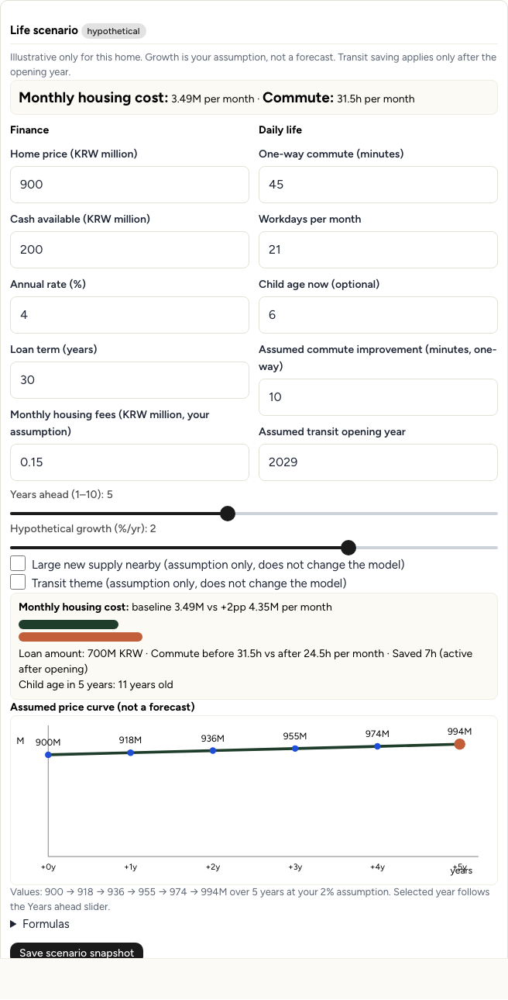

# Homeless Society

An open-source interactive home-visit and life-scenario notebook for people preparing to buy a home in South Korea.

[](LICENSE)
[](docs/BACKEND.md)
[](docs/architecture.md)
[](https://astryx.atmeta.com/)

[Quickstart](#quickstart) · [How the three steps work](#how-the-three-steps-work) · [Gallery](#gallery) · [Data and privacy](#data-and-privacy) · [Contributing and license](#contributing-and-license)

**Start with one click. No account. No keys.** Prepare, walk through two fictional homes, and compare what you found.

> Origin: information asymmetry around jeonse, Korea's large refundable rental deposits. This MVP helps you ask better questions, keep dated evidence, and compare two homes. It does not detect fraud and does not replace registry, contract, or on-site checks.

## Screenshots from this build

Fictional scene and sample fixture data captured by automated browser tests, not real Mapo data. Screenshots are original and unedited. Live handler Mapo September 2026 (84 rows) verified separately.

<table>
<tr>
<td></td>
<td></td>
</tr>
<tr>
<td>Prepare: priorities, district sample, and assumptions.</td>
<td>Explore: schematic visit with field notes per home.</td>
</tr>
</table>

Living documentation: [Korean companion](README.ko.md) · [Getting started in Korean](docs/GETTING_STARTED.ko.md) · [Architecture](docs/architecture.md) · [Data sources](docs/DATA_SOURCES.md) · [Backend](docs/BACKEND.md) · [Provenance](docs/PROVENANCE.md) · [Design rounds](docs/DESIGN_ROUNDS.md) · [Contributing](CONTRIBUTING.md)

## Quickstart

Requirements: Node `>=22.12.0` and npm.

```sh
git clone https://github.com/halo-sw/homeless-society.git
cd homeless-society
npm ci
npm run dev
```

Open `http://localhost:5173`. The local API runs on port `3001`.

Press **Enter simulation** on the first screen. It starts immediately.

The fictional scene works without any environment keys. Live housing lookup needs network access to the third-party proxy.

Other useful commands:

```sh
npm test                # unit and integration tests
npm run build           # typecheck + frontend + local Express server
npm start               # serve the local built app on port 3001
npm run build:web       # static PUBLIC-mode frontend in dist/ plus api/housing.ts for Vercel
npm run preview         # preview the static public build on port 4173
```

`npm run preview` does not run the serverless housing handler. Use `npm run dev` or a Vercel deployment for live housing data.

Never paste personal paths, auth tokens, credentials, real addresses, or real amounts into issues or docs.

## How the three steps work

### 1. Prepare

Choose up to 3 daily priorities. Add optional first questions. Research a district. Optionally set 12 factor weights or a preset, plus real addresses for reference.

District search example: type `마포구`, select `서울특별시 마포구 (lawd_cd 11440)`, choose an explicit month and asset, then Load past sales. The sample is read-only and kept separate from your notes.

### 2. Explore a virtual visit

Walk through 2 fictional homes, Sunlit House and Moonlight House in Solan Village, across 3 stops: Street, Daily route, and Entrance.

Switch home and stop. Use three Astryx tabs: Field notes, Life scenarios, and Housing checks.

A note stores text, an open question, source URL and date, and a classification. You can mark resolved, edit, delete, and undo. Notes, factor evidence, and scenario drafts are isolated per home.

The Field guide in PUBLIC mode is explicit prewritten Muse-authored prompts, not live generative AI. Local mode can optionally call a configured local Muse assistant.

The scene is a native SVG isometric neighborhood. It has an hour slider for day and night, park, school, cafe, grocery, and station markers, traffic and pedestrian motion, selectable layers, camera rotate and zoom, and reduced-motion support. It is schematic, not a physical reconstruction.

### 3. Compare and decide next visits

Side-by-side observations and missing evidence. Per-home saved scenario summaries. Factor coverage. Real district sample with source. Unresolved questions. Printable checklist. Visit memos. Return to visit. A complete flag that is separate from all-questions-resolved.

Export and import JSON for backup. Browser autosave uses `localStorage` version 1. JSON limit is 200KB. Import validates schema, size, URLs, and numeric ranges.

Persistence is browser-only. No accounts. No cloud sync. Export files contain addresses and notes, so share them deliberately. No analytics is configured.

## Gallery

<table>
<tr>
<td></td>
<td></td>
</tr>
<tr>
<td>Compare evidence before your next visit.</td>
<td>Bounded 1 to 10 year what-if plan, not a price prediction.</td>
</tr>
</table>

## What it can and cannot do

Capabilities:

- English UI built with React 19, Vite 8, TypeScript, Astryx 0.7.4 core and neutral theme, and StyleX. Uses Astryx Button, Badge, Slider, and SegmentedControl.
- Light field-journal and planning-studio design. Map-centered two-column desktop layout, stacked mobile layout. Plain accessible forms.
- 12 factor categories: commute and jobs; transit and last mile; schools; groceries and healthcare; parks; noise, daylight, air, and flood; terrain, accessibility, and parking; building, layout, and upkeep; monthly cost; title, claims, tenant, and deposit; community and news; development, supply, and population.
- Each priority weight is 0 to 3. Commuter, family, and first-home presets. Evidence states are missing, unverified, self-reported, or linked. Linked and self-reported mean coverage, not independently verified truth.
- Scenario inputs: price and cash in KRW million, mortgage annual rate and term, fees, one-way commute minutes and workdays, optional child age, years ahead from 1 to 10, assumed transit improvement and opening year, and user growth from -5 to 5 percent per year.
- Scenario math: equal-payment mortgage plus fees, baseline versus plus 2 percentage-point rate stress, round-trip commute hours per month, transit saving only after the assumed opening year, child age shown later without admission prediction, and assumed price curve `P*(1+g)^t`. Stores up to 20 snapshots total; Compare shows the latest per home. Default monthly fees are 0.15M KRW, meaning 150,000 KRW. Values are example assumptions.
- Supply and transit thematic checkboxes give qualitative explanations only, with no quantified coefficient.

Limits:

- Does not detect fraud. Does not replace registry, contract, title, flood, building-register, school, commute, legal, news, or on-site checks. Those remain manual references.
- No invented quality ratings, price prediction, school-admission prediction, or crime scores.
- Taxes, insurance, eligibility, and actual loan approvals are excluded.
- A district real-transaction sample is contextual evidence. It is not mapped into the fictional town. Not every factor is automatically collected.
- The lifetime simulator is a long-term direction. The delivered MVP is a bounded what-if tool plus a fictional walkthrough, not a digital twin of an arbitrary Korean district.
- No causal claim: data does not prove a future price rise.

## Data and privacy

Implemented endpoint: `GET /api/housing?kind=regions&q=...` and `kind=trades&lawd_cd=11440&deal_ymd=202609&asset=apartment`.

The same shared `server/housing.ts` logic is used by local Express and by `api/housing.ts` on Vercel.

Mapped assets are apartment, officetel, villa, and single-house. Actually live-validated on 2026-10-27 is only apartment, Mapo September 2026 with 84 valid rows. Other asset paths are wired, but upstream responses may fail strict validation. Errors are shown honestly with no automatic mock substitution.

Fields when available: apartment name, district, area, floor, reported price, date, build year, and deal type. No exact property geocoding and no active inventory. At most 100 upstream rows and 20 stored rows. Summaries are computed over the validated sample. A sample median is not a district market estimate. API units are 10,000 KRW. UI transaction price in millions equals price in 10,000 KRW divided by 100. Only district, month, and asset are sent upstream, not notes or finances.

Source is MOLIT reported transactions through the k-skill proxy. Third-party availability can fail. See [Data sources](docs/DATA_SOURCES.md).

Local AI is optional and server-only. PUBLIC mode exposes and calls no `/api/muse`. See [Backend](docs/BACKEND.md).

## Documentation map

- [README.en.md](README.en.md): short pointer to this canonical English README.
- [README.ko.md](README.ko.md): Korean companion guide.
- [docs/GETTING_STARTED.ko.md](docs/GETTING_STARTED.ko.md): detailed Korean walkthrough.
- [docs/architecture.md](docs/architecture.md): stack, routes, state, and boundaries.
- [docs/DATA_SOURCES.md](docs/DATA_SOURCES.md): canonical housing-data contract.
- [docs/data-sources.md](docs/data-sources.md): compatibility pointer to the canonical file.
- [docs/BACKEND.md](docs/BACKEND.md): local versus public behavior and environment setup.
- [docs/PROVENANCE.md](docs/PROVENANCE.md): authorship and rights.
- [docs/DESIGN_ROUNDS.md](docs/DESIGN_ROUNDS.md): what was implemented and what verification remains.
- [CONTRIBUTING.md](CONTRIBUTING.md): how to contribute safely.

Public demo pending; no live URL yet. Documented Vercel deployment uses `npm run build:web` with `dist/` output plus the `api/housing` function.

## Source attribution

- UI kit: [Astryx](https://astryx.atmeta.com/)
- Housing proxy documented by [k-skill](https://github.com/NomaDamas/k-skill), origin `https://k-skill-proxy.nomadamas.org`
- MOLIT transaction source: `https://rt.molit.go.kr/pt/xls/xls.do`
- `real-estate-search` skill consulted. `building-register-search` was researched but not integrated.
- School, map, and open-data references are listed in [Data sources](docs/DATA_SOURCES.md).
- Mapbox isochrone playground and Seoul maps were interactive design research and inspiration only. No embedded Mapbox or paid map API is used.
- README structure is inspired by [Anatomy](https://github.com/wheresryan22/anatomy). Its UI, images, code, and agent-skill concept are not used or copied.

## Contributing and license

Newcomers are welcome. Confusing sentences, reproduction steps, docs fixes, translations, and accessibility feedback are especially useful.

Please discuss code scope first. App code is authored by Muse Spark 1.3 only. Use fictional examples. Do not post real addresses, amounts, keys, or personal spending. Read [Contributing](CONTRIBUTING.md) and [Provenance](docs/PROVENANCE.md).

Verification: TypeScript typecheck + PUBLIC build passed; `npm test` (65 unit/integration passed); local end-to-end (15 passed); public end-to-end (1 comprehensive passed covering district fixture, prewritten field guide with 0 Muse calls, A900/B800 draft isolation + snapshots, clear + JSON import persist, and 390 mobile overflow). Commands: `npm test`, `npm run build:web`, `npm run test:e2e`, `npm run test:e2e:public`. Latest recorded results: [source-provenance.json](docs/source-provenance.json). `docs/ci-template.yml` is an inactive template; no active CI.

MIT license covers our code only. Map, content, and provider rights belong to their providers.
