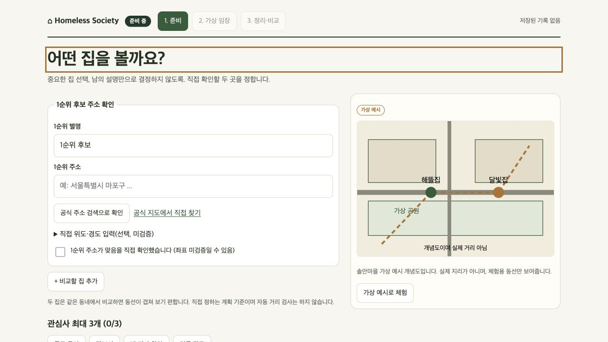
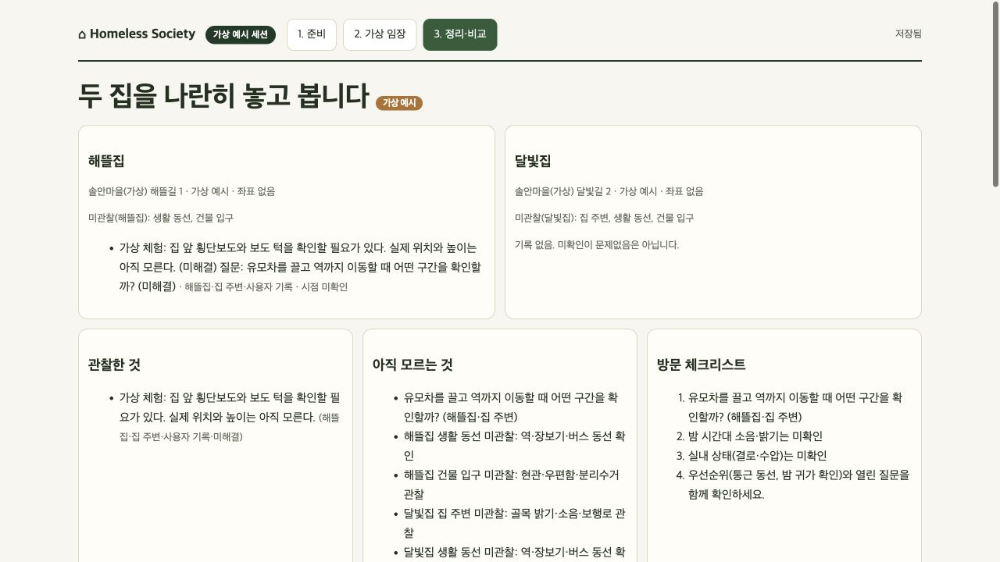

# 처음부터 따라 하는 이용 안내

이 문서는 설치가 낯선 분도 천천히 따라 할 수 있도록 썼습니다. 터미널은 명령을 적는 화면이며, 브라우저는 집 기록이 보이는 화면입니다. 공개된 체험용 누리집은 없으므로 자신의 컴퓨터에서 직접 실행합니다.

## 준비물

| 준비물 | 설명 |
|---|---|
| 컴퓨터 | macOS에서 동작을 확인했습니다 |
| Git | 소스를 가져오는 도구 |
| Node.js | 화면과 서버를 실행하는 도구이며, npm이 함께 들어 있습니다 |

Node.js는 `22.22.3`에서 테스트했고, 요구 조건은 `>=22.12`입니다. 가능하면 테스트한 버전을 권장합니다. 공식 Git과 Node.js를 먼저 설치하세요. 처음 데모에는 API 키나 `.env` 파일이 필요 없으며, 가상 예시는 유료 AI 호출 없이 실행됩니다.

## 소스 가져오기와 실행

터미널에 한 줄씩 입력합니다.

```sh
git clone https://github.com/halo-sw/homeless-society.git
cd homeless-society
npm ci
npm run dev
```

성공하면 브라우저에서 http://127.0.0.1:5173 을 엽니다. 멈출 때는 터미널에서 `Ctrl+C`를 누릅니다. 개발 실행과 운영 실행을 같은 컴퓨터에서 함께 켜지 마세요.

운영 형태로 보려면 다음 명령을 씁니다.

```sh
npm run build
npm start
```

이때 주소는 http://127.0.0.1:3001 하나이며, 화면과 저장이 모두 이 주소에 있습니다. 개발 주소에서 적던 기록과 저장 공간이 다르므로, 주소를 바꾸기 전에 기록 JSON을 먼저 내려받으세요.

## 첫 화면 고르기



주소 입력 양식은 첫 화면에 바로 보입니다. **가상 예시로 체험**은 주소를 적지 않고 가상의 솔안마을로 연습하는 길이며, 키가 필요 없습니다. **내 주소로 시작**은 주소를 직접 적은 뒤 확인란까지 마치고 누르는 길입니다.

예전에 적던 기록이 남아 있으면, 새로 시작하기 전에 확인을 물을 수 있습니다. 그 문구에 답한 뒤에 원하는 쪽을 고르세요.

## 가상 예시로 연습하기


*위 화면은 실제 앱의 도식 화면이며, 실제 로드뷰가 아닙니다.*

가상 마을에는 해뜰집과 달빛집이 있으며, 모두 가상의 이름입니다. 관찰 지점은 집 주변, 생활 동선, 건물 입구의 세 곳입니다. 집 이름 옆의 탭으로 집을 바꿀 수 있으며, 바꾸기 전에는 **기록 추가**를 눌러 저장하세요. 저장하지 않은 입력은 사라질 수 있습니다.

각 집과 지점에서는 다음 순서로 적습니다. 관찰 내용에 본 것을 적고, 남은 질문에 궁금한 점을 적습니다. 출처 URL과 출처 날짜를 함께 적을 수 있으며, 주소는 `http`나 `https`만 됩니다. 마지막에 **기록 추가**를 누릅니다.

아래는 앱에서 실제로 받은 Muse 응답이 아닌, 작성 연습용 가상 예시입니다.

- 해뜰집 연습 예시: 관찰에 `낮에는 골목이 밝아 보였으나, 밤 귀갓길 가로등 간격은 아직 모른다.`를 적고, 질문에 `밤 10시 이후 골목 입구부터 현관까지 어디가 가장 어두운지 확인하고 싶다.`를 적습니다.
- 달빛집 연습 예시: 관찰에 `장보기가 가까운 동선은 확인했으나, 저녁 시간대 골목 소음은 아직 모른다.`를 적고, 질문에 `평일 저녁에 창문을 열었을 때 들리는 소리를 확인하고 싶다.`를 적습니다.

거리나 시간을 추측하지 말고, 모르는 것은 모른다고 적습니다. 기록은 고치거나 지울 수 있고, 되돌리기도 됩니다. **내 확인 완료로**는 본인이 확인했다는 표시이며, 외부 검증이 아닙니다.

## 정리하고 비교하기



**정리·비교로**를 누르면 집별 관찰이 모이며, 남은 질문과 출처, 날짜도 함께 보입니다. 아직 보지 않은 지점도 표시되므로 어디가 비었는지 알 수 있습니다. 화면은 **관찰한 것**, **아직 모르는 것**, **방문 체크리스트**로 나뉩니다. 자동 추천이나 순위는 없습니다.

집마다 날짜가 들어간 방문 메모를 적고 **메모 저장**을 누릅니다. 이어서 **방문 체크리스트 저장**으로 텍스트 파일을 내려받고, 필요하면 **방문 시트 인쇄**로 종이 준비물을 만들고, **기록 JSON 저장**으로 파일을 내려받으면 기본 여정이 끝납니다.

## 저장·내보내기·이어보기

| 버튼 | 결과 |
|---|---|
| 방문 시트 인쇄 | 브라우저 인쇄 화면이 열립니다 |
| 방문 체크리스트 저장 | `visit-checklist.txt`가 내려받아집니다 |
| 기록 JSON 저장 | `homeless-society-session.json`이 내려받아집니다 |
| 기록 가져오기 | JSON을 검사한 뒤 저장된 단계로 돌아갑니다 |
| 세션 완료로 표시 | 기록 정리를 마쳤다는 표시이며, 질문 해결과는 별개입니다 |

기록은 같은 기기, 같은 브라우저, 같은 주소에 저장됩니다. 개발 주소와 운영 주소는 저장 공간이 다르므로, 브라우저를 바꾸거나 기록을 지우기 전에 꼭 내려받으세요. JSON에는 주소와 메모가 들어 있으므로 공유하기 전에 열어보세요.

모든 입력 칸이 저절로 저장되지는 않으므로 버튼으로 저장하세요.

## 실제 주소로 살펴보기

**내 주소로 시작**을 쓰려면 먼저 양식을 채웁니다. 기본 주소와 선택 사항인 별명, 선택 사항인 두 번째 후보를 적습니다. 관심사를 최대 3개 고르고 첫 질문을 적은 뒤, 공식 지도 링크를 열어 주소를 직접 확인합니다. 확인란에 표시한 다음 **내 주소로 시작**을 누릅니다.

위도·경도 직접 입력은 가능하지만 필수는 아니며, 좌표가 자동으로 검증되지는 않습니다. `LIVE`는 내 주소 모드라는 표시이며, 실시간 자료나 제공자 확인을 뜻하지 않습니다. 키가 없어도 수기 관찰과 비교 흐름은 그대로 쓸 수 있습니다.

지도·로드뷰 연결 코드는 구현되어 있으며, 실제 키를 이용한 검증은 아직 진행하지 않았습니다. 거리뷰 제공 여부와 촬영 시기는 자료와 지역 사정에 달려 있으며, 모르면 모른다고 표시합니다.

## Muse 연결: 선택 사항

Muse 모델은 `muse-spark-1.3`만 쓰며, 없어도 앱을 쓸 수 있습니다. 화면에 **Muse 확인 질문** 구역이 있으며, **Muse에게 다음 확인 질문 받기**를 누른 그때 선택한 집 한 곳의 정보가 전달됩니다. 여기에는 주소, 그 집의 관찰과 메모, 관심사 최대 3개와 처음 적은 질문이 포함됩니다. 두 집이 함께 가지 않으며, 사진이 자동으로 가지 않습니다.

Muse가 설정된 경우에만 요청이 본인의 로컬 서버를 거쳐 Meta에 전달됩니다. 키 없이 보는 로컬 안내는 Meta에 전달되지 않습니다. 돌아오는 답은 최대 3개의 다음 확인 질문이며, 각 질문에는 근거 번호가 붙습니다. API 키 또는 인증된 CLI와 예산이 설정되지 않았다면 로컬 안내가 표시됩니다. 이 문구는 `기본 확인 질문 · AI 연결 전 (로컬 안내)`로 표시되며, 미리 들어 있는 안내이지 모델이 만든 답이 아닙니다.

연결 상태가 `구성됨 · 연결 미테스트`라면 설정은 있으나 아직 답을 받지 못한 상태이며, 성공적으로 답을 받았다는 뜻이 아닙니다.

### 설정 파일 만들기

처음 체험에는 설정 파일이 필요 없습니다. Muse 연결이 필요해지면 예시 파일을 복사한 뒤 직접 편집합니다. Windows에서는 파일을 직접 복사해도 됩니다.

```sh
cp .env.example .env
```

서버 설정을 바꾼 뒤에는 서버를 다시 시작하세요. 브라우저에 보이는 `VITE_` 값을 바꿨다면 운영 배포 전에 다시 빌드하세요. 실제 키는 절대 올리지 마세요.

둘 중 하나를 고르고 다른 쪽은 비워 두세요. 이미 인증된 공식 Muse CLI 또는 공식 API 자격 증명을 사용하세요.

| 선택지 | 뜻 | 예시 |
|---|---|---|
| MODEL_API_KEY | Meta API 키 | MODEL_API_KEY=your_meta_api_key |
| MUSE_BIN | 이미 인증된 공식 CLI의 전체 경로 | MUSE_BIN=/absolute/path/to/muse |

`your_meta_api_key` 자리에 본인 키로 바꾸고, 파일을 공유 저장소에 올리지 마세요. Meta 이용 자격과 요금은 본인 계정에서 확인하세요. 예산과 횟수는 `.env` 파일 안에 다음과 같이 적습니다.

```env
MUSE_BUDGET_USD=2
MUSE_MAX_CALLS=10
```

`MUSE_BUDGET_USD`는 반드시 양수로 정하는 서버 내부 상한이며, 공용 계정 잔액이 아닙니다. 실행 파일 방식은 요청마다 US$1.90을 정액으로 부과하는 것이 아니라 미리 확보해 두고 실제 사용량으로 정산하므로, 남은 예산이 `1.90` 이상이어야 시작됩니다. 기본 기록 경로는 `./data/muse-ledger.json`이며, 하나의 기록 파일에는 API 서버 프로세스 한 개만 연결하세요. 기록이 이상해도 파일을 지워서 예산을 풀지 마세요.

요청 제한 시간은 API 45초, 실행 파일 120초이며, 자동 재시도는 없습니다. 자세한 계산은 [백엔드 안내](BACKEND.md)를 보세요.

## 카카오 지도 연결: 선택 사항

주소 찾기는 서버 키 `KAKAO_REST_API_KEY`를 쓰고, 보이는 지도와 로드뷰는 `VITE_KAKAO_JS_KEY`를 씁니다. 뒤쪽 키는 브라우저에 보이는 앱 키이며, 서버 비밀키가 아닙니다. 카카오 앱 설정에서 쓸 웹 주소를 허용해야 합니다.

지도·로드뷰 연결 코드는 구현되어 있으며, 실제 키를 이용한 검증은 아직 진행하지 않았습니다. 거리뷰가 모든 곳에 있지 않을 수 있으며, 촬영 시기를 모르면 모른다고 표시합니다. 지도 기능을 쓰면 주소와 좌표가 카카오로 전달됩니다.

## 잘 안 될 때

| 증상 | 먼저 확인할 것 |
|---|---|
| 화면이 안 열린다 |실행 명령이 켜져 있는지, 주소가 맞는지 |
| 포트가 이미 쓰인다고 나온다 | 개발 실행과 운영 실행을 함께 켜지 않았는지 |
| 가상 예시가 안 열린다 | 예전 기록 확인 문구가 있는지 |
| 가져오기가 안 된다 | JSON 파일을 직접 고치지 않았는지 |
| AI 답이 안 온다 | 키와 예산 설정, 서버 재시작 여부 |
| 지도 자리가 비었다 | 키와 허용한 웹 주소 설정 |

그래도 어려우면 가능하면 눌렀던 버튼과 나온 문구를 그대로 적어 알려주세요. 가상의 연습 기록은 괜찮지만, 실제 주소나 금액, 키는 적지 마세요.

## 다음 문서

- [구조 안내](architecture.md)
- [자료 출처 안내](data-sources.md)
- [백엔드 안내](BACKEND.md)
- [출처 기록](PROVENANCE.md)
- [보안 안내](../SECURITY.md)
